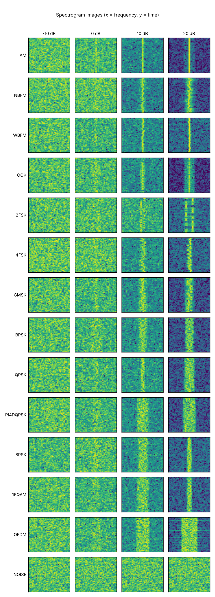
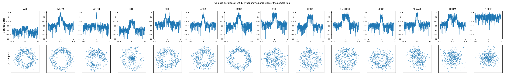
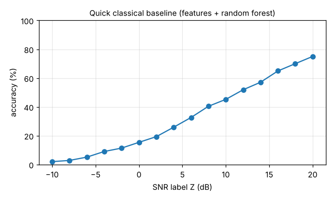

# Dataset 1 (synthetic), version 3

**224,000 labelled I/Q clips, 14 classes, 16 SNR levels.** File `ds1_v3.h5` (1.84 GB), made with
`python make_synth_v3.py --per-snr 1000 --out ds1_v3.h5` (seed 2026). No SDR involved.
Spectrogram images of the same clips: `ds1_v3_spec.h5` (0.92 GB), made with `make_spectrograms.py`.

## Why these 14 classes

İLTAREN left the choice of modulation types to us. We chose them from what is actually transmitted in the V/UHF band
(30 MHz - 3 GHz), not from what academic datasets contain. Academic sets (RadioML, Sig53, HisarMod) focus on high-order
PSK/QAM/APSK and miss the land-mobile modes (4FSK, π/4-DQPSK) that dominate V/UHF. We still share AM, FM, OOK, GMSK,
BPSK, QPSK, 8PSK and 16QAM with RadioML 2018, so results stay comparable with the literature.

| Class | Where you meet it in V/UHF | How it is generated |
|---|---|---|
| AM | aircraft voice radio 118-137 MHz, military aircraft 225-400 MHz | double sideband with carrier, depth 0.3-0.9 |
| NBFM | walkie-talkies, land mobile, ship radio, military VHF 30-88 MHz | voice-like message, modulation index 0.5-2 |
| WBFM | FM broadcast 87.5-108 MHz | 75 kHz deviation, 15 kHz audio; 70 % stereo with 19 kHz pilot |
| OOK | remotes and sensors at 315 / 433.92 / 868 MHz | on-off keying, root-raised-cosine pulses |
| 2FSK | pagers (POCSAG), MPT 1327, telemetry | continuous-phase FSK, index 0.5-2.5 |
| 4FSK | DMR, dPMR, NXDN (66-860 MHz, 12.5 kHz) | 4 levels, index 0.25-0.6, smoothed tones |
| GMSK | AIS ship tracking 161.975 / 162.025 MHz, GSM-900, Tetrapol | index 0.5, Gaussian filter BT 0.3-0.5 |
| BPSK, QPSK | satellite and military data links | root-raised-cosine, roll-off 0.2-0.5 |
| PI4DQPSK | TETRA public-safety radio (typically 380-430 MHz) | phase turns ±45° or ±135° each symbol |
| 8PSK | VDL Mode 2 aircraft data link (117.975-137 MHz) | root-raised-cosine, roll-off 0.2-0.5 |
| 16QAM | trunked-radio data links; inside OFDM | root-raised-cosine, roll-off 0.2-0.5 |
| OFDM | DAB radio, DVB-T television, LTE, Wi-Fi | 64/128/256 subcarriers, QPSK or 16QAM, cyclic prefix 1/4 or 1/8 |
| NOISE | — | no signal: teaches the model to say "nothing here" |

Every clip: 1,024 samples, random phase, frequency offset up to 0.2 % of the sample rate, white Gaussian noise,
scaled to average power 1. Every signal fills a random 10-35 % of the clip's band, like a real signal after our
preprocessing (resampled to 4 x its bandwidth), so the model must learn the modulation itself, not the signal width.
Sample rate is normalised to 1. `--fading` adds a light two-path echo. Stretch goals, not clip classes: frequency
hopping (e.g. SINCGARS, Have Quick) and LoRa chirps; they belong with the detector.

### Changes from version 2

- FM split into NBFM (voice) and WBFM (broadcast, with stereo pilot); added OOK and PI4DQPSK (TETRA).
- 4FSK now uses the small modulation index of DMR-type radios; 2FSK covers the large index of pagers.
- All classes now fill a similar part of the band (10-35 %), matching the SDR preprocessing.

## SNR labels

- `Z`: **Es/N0** for OOK, 2FSK, 4FSK, GMSK, BPSK, QPSK, PI4DQPSK, 8PSK, 16QAM; **in-band SNR** for AM, NBFM, WBFM, OFDM; NaN for NOISE.
- `Z_inband`: in-band SNR for every clip = signal power / noise power inside the 99 % occupied bandwidth (AM: 2 x message bandwidth).
- Levels: -10 to +20 dB in 2 dB steps, 1,000 clips per class per level. Adjusted once İLTAREN confirms its SNR definition.

## File layout

| Name | Shape, type | Meaning |
|---|---|---|
| `X` | (N, 1024, 2) float32 | clips; `[:, :, 0]` = I, `[:, :, 1]` = Q |
| `Y` | (N,) int64 | class number, in the order of `attrs["classes"]` (= `classes.txt`) |
| `Z`, `Z_inband` | (N,) float32 | SNR labels in dB (see above) |
| `sps` | (N,) float32 | samples per symbol (0 for AM, NBFM, WBFM, OFDM, NOISE) |
| `bw99` | (N,) float32 | occupied bandwidth as a fraction of the sample rate |
| `split` | (N,) int8 | 0 train (70 %), 1 validation (15 %), 2 test (15 %) |

Attributes: `classes`, `sample_rate`, `source`, `version`, `snr_definition`, `split_codes`, `settings`, `created`.

```python
import h5py, numpy as np
with h5py.File("ds1_v3.h5", "r") as f:
    classes = list(f.attrs["classes"]); Y, Z, split = f["Y"][:], f["Z"][:], f["split"][:]
    train = np.where(split == 0)[0]
    X_train = f["X"][train[:50000]]          # read only what you need: the full X is 1.84 GB
```

## Spectrogram images (for image-based models)

`make_spectrograms.py` turns every I/Q clip into a 64 x 64 grayscale spectrogram (waterfall layout: rows = time, columns = frequency,
0 Hz in the middle). Each clip is cut into 64-sample pieces every 16 samples, each piece is Fourier-transformed with a Hann window,
converted to dB, and the top 40 dB below the image's brightest pixel are mapped to 0-255.

```bash
python make_spectrograms.py ds1_v3.h5 --out ds1_v3_spec.h5                  # S (N, 64, 64) uint8 + Y, Z, Z_inband, split
python preview_spectrograms.py ds1_v3_spec.h5 --snr -10 0 10 20             # spectrogram_examples.png
python make_spectrograms.py ds1_v3.h5 --out ds1_v3_spec.h5 --png-dir spec_png --png-per-class 300   # also PNG folders
```

Image i belongs to clip i, so labels and splits stay identical to the I/Q dataset. For pretrained ImageNet-style networks that
expect 224 x 224 x 3, resize and repeat the channel in the training loader rather than storing 224 x 224 images (11 GB for the
full dataset instead of 0.92 GB). Options: `--nfft`, `--hop`, `--range` (dB), `--size`.



## Checks (`python check_synth.py ds1_v3.h5 --baseline`)

- Format: all checks pass (shapes, types, attributes, power 1, no NaN, 16,000 clips per class).
- SNR: the in-band SNR measured from each clip's spectrum agrees with the stored label within 0.1-0.4 dB at 10 dB for every class.
- Data check with a simple test classifier (9 hand-made features + random forest, trained on 40,000 clips): 75 % at 20 dB,
  45 % at 10 dB, 15 % at 0 dB. Accuracy rises with SNR as it should. It is lower than for version 2 (84 %) because version 3
  adds look-alike classes (QPSK / PI4DQPSK / 8PSK, NBFM / WBFM) and no longer lets signal width give the answer away.
  This only shows the data works; it is not our classifier.




## Known limits (planned next)

- One signal per clip; no real hardware effects (IQ imbalance, DC spike, 8-bit rounding); fading only with `--fading`.
- Wideband scenes with several signals for the detector are not included yet.
